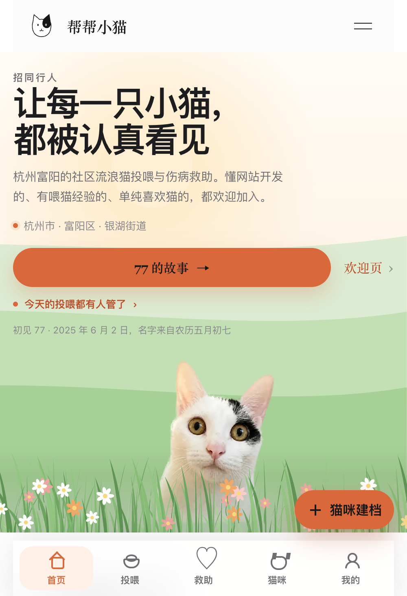
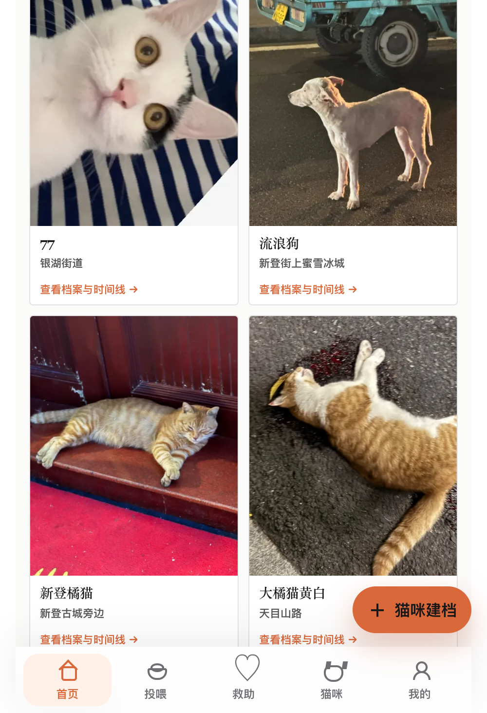

# H5 页面编排与收敛方案

2026-10-08 · 基于线上 r35 的实测数据（不是估算）。目的：把"介绍型首页"改成"动作型首页"，并让每个页面只承担一件事。

现状截图（390 宽手机视口）：

---

## 一、现状清点（实测高度 / 屏数 / 区块 / 可点元素）

| 页面 | 路由 | 高度 | 屏数 | 区块 | 可点元素 | 主要问题 |
|---|---|---|---|---|---|---|
| 首页 | `#home` | 4181px（含头尾） | **5.3** | 7 | **20** | 三块"讲道理"挡在内容前面；CTA 4 个 |
| 猫咪档案 | `#cats` | 3774px | 5.2 | 5 | 17 | 网格 3417px 里混着「流浪狗」「暂无照片」 |
| 77 的故事 | `#story-77` | 3104px | 4.2 | 1 | 7 | 长叙事，无章节锚点 |
| 定点投喂 | `#feeding` | 730px | 1.0 | 8 | 4 | 8 块里 3 块是空态；"刷新"出现两次 |
| 救助任务 | `#tasks` | 556px | **0.8** | 5 | 2 | 几乎全空（"暂时没有开放任务"） |
| 我的 | `#profile` | 317px | **0.4** | 3 | 5 | 未登录时只剩一张卡 |

弹层 6 个：`auth`（登录/注册）、`cat-sheet`（新增猫咪档案）、`contact-sheet`（加入我们）、`cat-detail-sheet`（猫详情）、`feed-sheet`（打卡并记录）、`task-sheet`（上报任务完成）。

底部导航 5 项：首页 / 投喂 / 救助(tasks) / 猫咪 / 我的。

---

## 二、诊断（每条都有数据）

1. **信息预算倒挂**：首页 5.3 屏、20 个可点元素；真正的功能页 0.4~1.0 屏。用户先看到的是"介绍"，不是"能做的事"。
2. **首页七块里三块在讲道理**：今天(258) + 三件事(523) + 成果(294) = **1075px ≈ 1.5 屏**，真正的内容（猫/任务）被推到 1900px 之后（第 3 屏）。
3. **内容治理缺失**：`#cats` 的网格里出现「流浪狗」（新登街上蜜雪冰城）和「暂无照片」条目；首页预览同样带空数据 —— 页面最乱的地方来自"没有过滤"。
4. **同一件事说两遍**：成果块写"数字来自管理员逐条录入的真实记录"，底部 WHY TRUST US 又讲一遍"我们怎么保证真实"（510px）。
5. **空状态占位过大**：`#feeding` 的连续打卡(145) + 未来 7 天(122) + 历史(63)、`#tasks` 的列表(253) 全是空态文案 —— 页面看着满，实际没内容。
6. **标签体系官网化**：5 个英文 eyebrow（招同行人 / HOW TO JOIN / OUR PROGRESS / WHY TRUST US / DAILY FEEDING）+ 每页 158px 的 `page-heading`（5 个页面各一个）。

---

## 三、目标原则

> **首页只回答"现在能做什么"；介绍性内容按需下移，或折成一行。**

- 首页 = 1 个主张 + **1 个主 CTA** + "今天要做的"3 个动作 + 真实内容预览（有照片的猫 + 开放任务）+ 一行成果数字 + 一行信任链接。
- 目标：首页 **4181 → ≈2200px（3 屏）**，可点元素 **20 → ≤8**。
- 每个页面**最多 1 个主 CTA**；空状态**必须给出口动作**，不能只有说明文字。

---

## 四、逐页编排

### 1. 首页 `#home`（动作 + 内容入口）

| 处理 | 内容 |
|---|---|
| **保留** | Hero（eyebrow + H1 + 1 句 + 1 主 CTA）、"今天要做的"（3 个动作按钮）、内容预览（猫 4 张 + 任务 2 条）、成果一行、信任一行 |
| **合并** | `today-section` + `pillar-section` → 一个"今天要做的"（顶部一行状态 + 3 个动作）；523+258 → **≈360** |
| **合并** | "77 的故事"按钮 + "初见 77 · 2025 年 6 月 2 日" → **一张故事卡**（一个入口） |
| **压成一行** | `impact-band` 三张数字卡 → "已救助 17 只 · 投喂 5 次 · 覆盖 11 个小区"（省 ≈200px） |
| **折成链接** | `trust-panel` 三条 → 一行"我们怎么保证真实 →"（正文移到故事页/关于页，省 ≈450px） |
| **删除** | 首页的 `feeding-teaser`（投喂在底部导航已有独立 tab；要看就在"投喂"页看） |
| **下移** | "欢迎页 ›" → 页脚 |

### 2. 猫咪档案 `#cats`

- `page-heading` 158 → **90px**；"已显示 16 只已审核猫咪 · 精确位置不会公开"并入标题区（现在单独占 29px）。
- **只展示"已公开 + 有照片"的猫**；非猫条目（流浪狗）单独归类或排除；`暂无照片` 的条目排到最后或折叠。
- 首屏必须出内容：现在 heading(158) + 筛选(110) 占了 268px，第一张卡要滚一下才看到。
- 空状态给动作："上报你遇到的猫 →"。

### 3. 救助任务 `#tasks`（现在 0.8 屏，几乎全空）

- 说明文案压成一行小字；空状态给两个动作（"我需要帮助" / "我能帮忙"）。
- **建议改职责**：如果长期没有任务，这个 tab 改成**"救助记录"** —— 把首页的成果数字做成主体（时间线 + 数字 + 照片），任务列表作为其中一节。否则一个总是空的 tab 会一直占着底部导航。

### 4. 定点投喂 `#feeding`（1 屏，8 块里 3 块空）

- 合并 `streak-card` + `shift-panel` + `feeding-history` → **一张"我的投喂"卡**（连续天数 / 未来 7 天我负责的班 / 最近打卡）。
- 未登录时整卡折叠成一行："登录后记录你的投喂 →"（省 ≈250px）。
- 删重复的"刷新"按钮（页面里出现两次）。

### 5. 我的 `#profile`（0.4 屏）

- 未登录只留一张卡：一句"登录后可以提交档案、查看审核进度" + **1 个登录按钮**。
- "我的提交""小区建议"收进登录后显示（现在未登录也占位）。
- `contact-sheet`（加入我们）与"志愿者账户"概念重合 → 统一成一个"成为志愿者"入口。

### 6. 77 的故事 `#story-77`（4.2 屏）

- 长叙事是合理的，但加**章节锚点/阅读进度**；首屏给两个出口："回首页"和"我也遇到一只猫 →"。

### 7. 欢迎页 `welcome/index.html`（入口页，5 块）

- 现状：hero / divider / contact-card / lead-section / feedback-card / explore。
- 建议：hero + **1 个主 CTA（留联系方式）** + 一段"这是什么" + 页脚；"新手做的，欢迎拍砖"的反馈卡降级成页脚一行。

---

## 五、全局收敛清单

1. 英文 eyebrow：**5 个 → ≤2 个**。
2. `page-heading` 统一 **90~110px**（现在 158px × 5 页）。
3. 每页**最多 1 个主 CTA**（首页现在 4 个）。
4. 空状态**必须有出口动作**（现在 tasks/feeding/profile 的空态只有说明文字）。
5. 首页预览类内容**必须过滤**：无照片 / 非猫 / 未公开。
6. "可追溯"这类表述只留一处（成果数字 or 信任面板，二选一）。
7. 底部导航保持 5 项不变，但"救助"的职责要定（任务 or 救助记录）。

---

## 六、实施与风险

- **契约测试**：`tests/test_product_h5_contract.py` 对 hero 结构与"最终级联"有硬断言（`.reference-hero` / `.editorial-hero-copy` / `.editorial-hero-visual`；这两块只允许 `background: var(--hero-backdrop)|transparent` 且 `border: 0`），另有 50 条其它断言 → 改版必须同步改测试，否则 CI 红。
- **无构建步骤**：改 `app/rescue/{index.html,styles.css,app.js}`，动效层保持在 `styles.css` 最末。
- **发布**：`scripts/bump_version.sh --next` → commit → `build_release.sh` → rsync → 激活 → **同步 IP 入口三份**（rescue/admin/welcome）→ `scripts/health_check.sh` 期望 17 项全过。
- **建议分两批**：
  - 批次一（低风险）：纯收敛 —— 删/合并/压缩元素，不动接口与数据结构。
  - 批次二：内容治理 —— 过滤非猫/无照片、空态动作、`tasks` 改造成"救助记录"。

---

## 七、需要产品侧定的三件事

1. **「流浪狗」要不要留在产品里？** 留 → 分类要改成猫/犬并给首页文案；不留 → 列表过滤掉。
2. **「救助」tab 的定位**：任务（现在几乎空）还是"救助记录"（把成果数字做成主体）？
3. **首页主 CTA 选哪个**：`今天要做的`（动作优先，推荐）/ `77 的故事`（品牌优先）。
